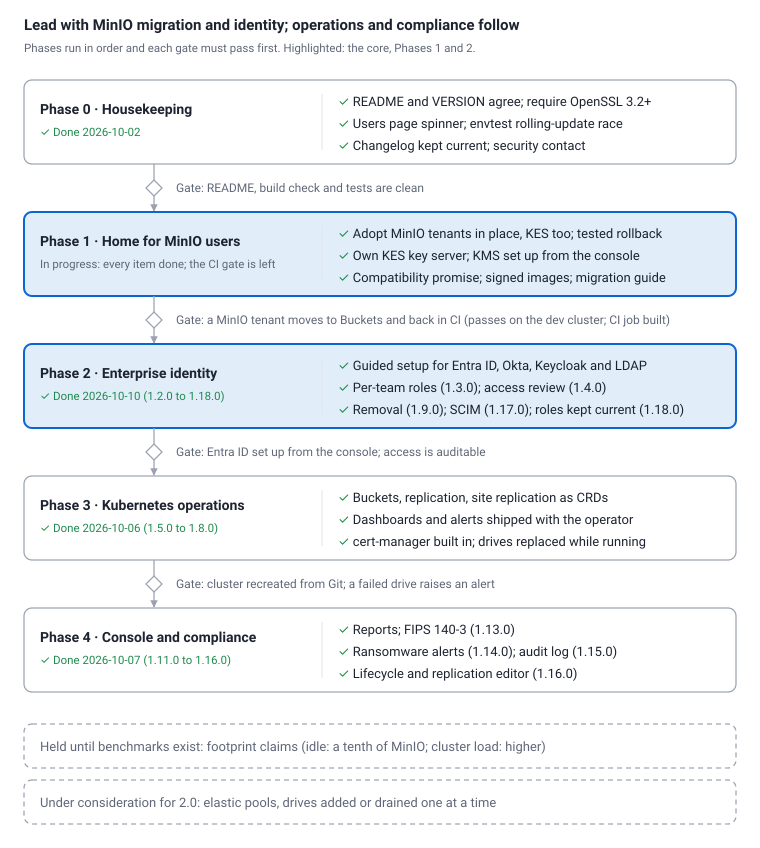

# Buckets Roadmap

As of 2026-10-16 · Russell Myers

## Summary

Buckets should become the maintained home for MinIO users, then win on enterprise identity and Kubernetes operations. Matching MinIO is done: Buckets is a C rewrite of MinIO's last public release and implements 220 of its 222 API handlers. MinIO's community project was archived in April 2026, so its users now need a supported successor more than another feature.

The order below leads with what builds on work that already exists (MinIO on-disk compatibility, the operator, Entra ID sign-in) and needs no storage-engine changes. Performance claims wait until benchmarks back them.

A successor can't depend on what it replaces. MinIO no longer publishes its images or binaries, so Buckets now ships its own key server (`buckets-kes`) in place of MinIO's KES, and keeps mirrors of MinIO's last images only for adoption and rollback.

**Where things stand (2026-10-16):** Buckets 1.20.2 is released, and the main repository is https://github.com/StorScale/buckets. Phases 0, 2, 3 and 4 are done. Every item of Phase 1 is done too.

- **Left in Phase 1:** its gate, the round trip in CI. The job (`adopt-roundtrip`) is built and waits for access to the cluster it runs on.
- **Phase 2 is done (1.2.0 to 1.18.0):** guided sign-in setup (1.2.0) for Entra ID, Okta, Keycloak, other OpenID providers and LDAP, per-team roles (1.3.0), the access review (1.4.0), removing people who leave Entra ID (1.9.0), Keycloak and Okta (1.10.0), SCIM for providers that push changes (1.17.0), and roles kept current (1.18.0).
- **Phase 3 is done (1.5.0 to 1.8.0):** monitoring and drive health, runtime drive replacement, console scheduling, cert-manager, and buckets, replication and site replication as resources.
- **Phase 4 is done (1.11.0 to 1.16.0):** the retention and encryption coverage reports (1.11.0), the usage and chargeback reports (1.12.0), FIPS mode (1.13.0), ransomware alerts (1.14.0), the audit log (1.15.0) and the lifecycle and replication editor (1.16.0).
- **Next:** security parity with AIStor and multi-tenancy (rate limiting and quotas), from a survey of the field on 2026-10-16. The lakehouse (managed Iceberg tables) is weighed for 2.0 beside elastic pools, and smaller survey items are in the backlog.

## Priorities at a glance

Phases 1 and 2 carry the case for choosing Buckets; Phases 3 and 4 make it easier to adopt and to sell to regulated teams. No dates are set yet: each phase starts when the gate before it passes.

## Phase 0: Housekeeping (done)

Small fixes that decide whether people trust Buckets as the maintained successor. Each is days of work, not weeks.

- [x] Update the README: it said "Status: 0.3.0" and "Next up is the Kubernetes operator", but `VERSION` is 0.10.0 and the operator ships. Done 2026-10-02.
- [x] Require OpenSSL 3.2 or later at configure time. The build accepts 3.0, then fails compiling Argon2 code.
- [x] Fix the brief loading spinner on the Users page when local users are hidden.
- [x] Fix the envtest rolling-update step, which fails on a race with or without recent changes ("pod not found").
- [x] Keep CHANGELOG.md current with each release, and publish a security contact so users can report issues.

## Phase 1: The maintained home for MinIO users (in progress)

The goal is a safe, supported move from an archived MinIO deployment to Buckets. Buckets already reads and writes MinIO's exact on-disk format, so this is packaging and tooling, not storage work.

- [x] **Adopt existing MinIO tenants.** The operator takes over a MinIO Operator tenant's volumes in place, with no data copy.
  - `scripts/adopt-minio.sh` plans by default, and with `--apply` saves the tenant, keeps its PVs and creates the `BucketsCluster`.
  - The operator gained the tenant's layout: `configuration` (config.env), `drives`, `securityContext`, `servicePort`, and extra volumes.
- [x] **A tested rollback.** `scripts/rollback-to-minio.sh` hands the drives back.
  - `tests/e2e-k8s/adopt-minio.sh` passes 29/29 on the shared cluster, from MinIO `RELEASE.2024-10-13` to Buckets and back with nothing lost.
  - MinIO older than `RELEASE.2024-10-29` can't read xl.meta metaVersion 3. For those, adoption sets `BUCKETS_XL_META_VERSION=2`, checked in `tests/integration/minio-rollback.sh`.
- [x] **Encryption without MinIO's components.**
  - `buckets-kes` is Buckets' own KES-compatible key server. It keeps keys exactly as MinIO KES does, so keys from an adopted deployment stay readable. It works with HashiCorp Vault, AWS Secrets Manager, Azure Key Vault and Google Secret Manager.
  - The console's Encryption page sets it up: choose the key store, test the connection with a temporary key server, then apply.
  - Keys can be created and deleted safely.
  - Objects stored unencrypted can be encrypted in place. See `docs/encryption.md`.
- [x] **Carry over a tenant's KES.** `scripts/adopt-minio.sh` maps the tenant's running KES configuration onto Secret `<tenant>-kms` and `spec.kms.kes` (`createKey: false`, the tenant's KES account and scheduling). `buckets-kes check` reads the default key before MinIO stops, and the servers wait for KES. `KES=1 tests/e2e-k8s/adopt-minio.sh` passes 44/44 on the shared cluster: MinIO's own KES on Vault, adopted by buckets-kes and rolled back, with MinIO decrypting what Buckets encrypted.
- [x] **A compatibility promise.** [docs/compatibility.md](compatibility.md) states what every 1.x release keeps compatible, across releases and with MinIO: the on-disk format (and handing drives back to older MinIO), the S3, admin and STS APIs, `mc` and the SDKs, events, audit and trace, metrics, configuration, KES, the CRDs and rolling upgrades. Each promise names the test that proves it, and the page lists what is not promised (mixed MinIO and Buckets clusters, among others).
- [x] **Release artifacts.** Since 1.1.0, each release tag publishes the four images to `ghcr.io/storscale`, signed with cosign (keyless, as the release workflow) and carrying an SBOM and build provenance. It also publishes the operator's Helm chart to `oci://ghcr.io/storscale/charts/buckets-operator`, signed the same way. All of these are public.
- [x] **A migration guide.** [docs/migration.md](migration.md) covers:
  - mirroring MinIO's images first, since they're gone upstream;
  - identity (MinIO config to Entra ID or Okta), TLS and monitoring;
  - KES.

Done when: a MinIO tenant with real data moves to Buckets and back again in CI, with no data loss. The round trip passes on the shared cluster (29/29, and 44/44 with KES). The CI job runs it on release tags and by hand on `main`, plain and with KES, once the pipeline can reach the cluster (`KUBE_CONTEXT` through the GitLab agent, or a `KUBECONFIG` variable).

## Phase 2: Enterprise identity (done)

Identity-provider sign-in with role-based access should be a feature people choose Buckets for, not a set of environment variables. Entra ID sign-in with app roles works today; this phase makes it easy to set up and to audit.

- [x] **Guided setup in the console** for Entra ID, Okta and Keycloak, replacing hand-written `MINIO_IDENTITY_OPENID_*` settings, with LDAP and Active Directory as well (Identity → Sign-in; see [identity.md](identity.md)). Each provider's steps are shown with the redirect URI to copy; a test sign-in (or LDAP lookup) checks the settings as the servers will before anything changes; the operator applies them to the servers (OpenID at once, LDAP with a rolling restart) and the console. `tests/e2e-k8s/identity.sh` passes on the shared cluster against a real Keycloak and OpenLDAP.
- [x] **Per-bucket and per-team roles** (1.3.0; Identity → Teams, see [identity.md](identity.md#teams) and [the design](design/teams.md)). A team is a name and its buckets, named or by prefix; each level becomes a `team-<name>-ro`, `-rw` or `-admin` policy, with the matching step for each identity provider. Teams are stored only as those policies, so they survive the MinIO round trip, which `tests/e2e-k8s/adopt-minio.sh` checks.
- [x] **Automatic provisioning and removal.** People who leave lose access and their access keys without manual cleanup. Done for Entra ID (1.9.0; [identity.md](identity.md#people-who-leave), [the design](design/identity-sync.md)): every hour the servers ask Microsoft Graph about each person holding credentials, revoke the temporary credentials of anyone deleted or disabled, and turn their access keys off, then delete them after 30 days. Provisioning needs nothing new with OpenID: access comes from roles at sign-in. Keycloak and Okta followed in 1.10.0, through the sign-in client's service account and a read-only API token; the cluster test disables a real Keycloak user. SCIM followed in 1.17.0 ([identity.md](identity.md#scim), [the design](design/scim.md)): Entra ID and Okta push who is turned off or deleted, acted on within seconds through the same removal, with SCIM alone or beside the sync. Roles followed in 1.18.0 ([identity.md](identity.md#roles-kept-current), [the design](design/roles-current.md)): each sync reads each person's roles or groups now, and their access keys and sessions are updated in place, so someone moved out of a role loses it on keys made before.
- [x] **An access review page** (1.4.0; Identity → Access review, see [identity.md](identity.md#access-review) and [the design](design/access-review.md)). Lists every route to a bucket, with its limits and the statements behind it, exports it as CSV, and answers whether a given principal would be allowed an action, using the servers' policy evaluator.
- [x] **Local-users policy** (1.4.0). The default stays (no local users while identity-provider sign-in is on), and the access review lists any local users that remain.

Done when: a new admin connects Entra ID from the console without editing environment variables, and an auditor can list everyone with access to a bucket.

## Phase 3: Kubernetes-native operations (done)

Everything about a Buckets cluster should be declared in Kubernetes and watched by default. The operator already handles pool expansion, drive replacement, rolling upgrades, TLS and console TLS; this phase fills the gaps found while deploying to the dev cluster.

- [x] **More resources as CRDs** (1.8.0; [the design](design/declarative-buckets.md)). A `Bucket` applies and keeps versioning, object lock, quota, default encryption, lifecycle rules and replication, putting back changes made by hand. `BucketsSiteReplication` adds and removes sites. The envtest replicates objects between two servers and sets up site replication across three.
- [x] **Monitoring shipped with the operator** (1.5.0; [monitoring.md](monitoring.md), [the design](design/monitoring.md)). The operator gives each cluster a least-privilege metrics user and ServiceMonitors; the chart ships 12 alert rules with runbooks and four Grafana dashboards. `bucketsd` now takes failing, hung and emptied drives offline, and `tests/e2e-k8s/monitoring.sh` checks on the shared cluster that a drive made to fail raises `BucketsDriveOffline`.
- [x] **cert-manager built in** (1.7.0). `spec.tls.certManager` has the operator ask cert-manager for certificates that name every Service and server, from your issuer or a CA of the cluster's own; renewals need no restarts. TLS stays opt-in, so existing plain-HTTP clusters are unchanged.
- [x] **Console scheduling fields** (1.6.0). `spec.console` takes `nodeSelector`, `affinity` and `tolerations`, as pools do.
- [x] **Exportable manifests** (1.8.0; [gitops.md](gitops.md)). A documented repository layout, `operator/examples/gitops`, that the envtest validates against the CRDs, plus how the operator treats what is in Git and an Argo CD health check.

Done when: a cluster, its buckets, policies and replication are created from one Git repository, and a failing drive raises an alert without anyone looking.

## Phase 4: Console and compliance (done)

The full admin console and OpenSSL 3 are already in place; this phase turns them into reporting and compliance features that regulated buyers ask for.

**Console**

- [x] **Usage and chargeback reports** (1.12.0; [usage-reports.md](usage-reports.md)): storage (GB-months and peak), data in and out, and requests per bucket and per team, for any period in the last 13 months, with costs from rates and CSV export.
- [x] **Audit log** (1.15.0; [audit-log.md](audit-log.md)): every request, by whom, from where and with what result, kept on each server and searched in the console (filters, details, CSV); forwarded to Microsoft Sentinel through the Logs Ingestion API, or to Splunk's HTTP Event Collector. With Entra ID sign-in, people appear by name.
- [x] **Lifecycle and replication editor** (1.16.0; [lifecycle-replication.md](lifecycle-replication.md)): lifecycle rules in words and a form, with a preview of what they'd delete or move and warnings before saving; replication set up in one form with a test, each target's state, resync, Reports → Replication and three alerts; buckets declared as `Bucket` resources shown read-only, with Copy as YAML.

**Compliance and security**

- [x] **FIPS 140-3 mode** (1.13.0; [fips.md](fips.md)): every security function in the OpenSSL FIPS Provider 3.1.2 (certificate #4985), in `-fips` images and with the operator's `spec.fips`; what isn't approved is refused, saying why.
- [x] **WORM compliance reports** (1.11.0; [compliance.md](compliance.md)): which buckets are locked, in which mode and for how long, and how much data is under retention or legal hold, per bucket, with CSV export.
- [x] **Encryption coverage reports** (1.11.0): which buckets encrypt by default and with which key (flagged when it no longer works), and how much data is stored encrypted, by kind, or not; per-bucket metrics for alerting on unencrypted data.
- [x] **Ransomware alerts** (1.14.0; [ransomware.md](ransomware.md)): bursts of deletes or overwrites against each bucket's usual rate, and weakened protection, named by bucket and credential; events, alerts, the console's Activity page, and optionally the credential turned off.

Done when: an auditor can get usage, access and retention reports from the console, and FIPS mode is documented and tested.

## Held until benchmarks exist: footprint and performance

A C server in a distroless image should use less memory than the Go original, which matters for edge and small-node deployments. Measured now on both: about a seventh of MinIO's memory idle, and about half under load in a cluster, with higher GET throughput and level PUTs.

- [x] **Throughput and latency on Kubernetes.** `tests/bench/cluster.sh` load-tests MinIO and Buckets on the same volumes and nodes. Profiling it on the shared cluster found two round trips on every read, fixed in 1.1.1; since then Buckets leads MinIO on small GETs in every run there (64 KiB: about 3,700 against 3,100–3,400 op/s). Large GETs traded places with MinIO from run to run until GETs read the server's own shards first (1.20.0): Buckets now leads by 23% on 1 MiB and 28% on 10 MiB (859 and 834 MiB/s against at most 697 and 652). PUTs are level, bound by the shared storage; since they make two calls per remote drive rather than seven, as MinIO's do, Buckets leads its own earlier builds by about 13% with 4 clients and matches MinIO from 1 to 32. See `docs/performance.md`.
- [x] **Memory measured** at idle and under load: `tests/bench/warp.sh` on one server against MinIO `RELEASE.2025-10-15T17-29-55Z`, `tests/bench/cluster.sh` on the shared cluster. Idle, Buckets uses about a seventh of MinIO's memory (9–15 MiB against 75–120 MiB per server). See `docs/performance.md`.
- [x] **Memory under load in a cluster** (1.19.0). Buckets 1.18.1 peaked higher than MinIO in the cluster (1,000–1,100 MiB per server against 650–730), though lower on one server. The cause was glibc's malloc, which after the first large freed buffer kept every buffer in its arenas and gave little back. `bucketsd` now fixes glibc's thresholds, and two buffers (aws-chunked uploads, idle connections) no longer start or stay large: Buckets peaks at about half of MinIO's memory in the cluster (360–390 MiB against 670–700) and a third or less on one server, with the same throughput.
- Publish the method and the raw results with each comparison.
- Market footprint or speed only where the numbers show a clear difference.

## Next: security parity and multi-tenancy

From a survey of the field on 2026-10-16 (AIStor, AWS S3, Ceph, SeaweedFS, Garage, RustFS and the enterprise appliances). Most of what competitors added in 2026 is the lakehouse, weighed for 2.0 below; these two pieces are smaller and carry the "maintained successor" promise directly, so they come first.

### Security parity with AIStor

MinIO's commercial line (AIStor) kept fixing security issues after the public release Buckets forked from, so Buckets may carry the same bugs. Keeping current with them is the cheapest way to hold the promise that Buckets is the safe place to land. Checked against AIStor `RELEASE.2026-07-24`:

- [x] Non-expiring OIDC/STS credentials. Already refused: a temporary user needs an expiry (`buckets_iam_set_temp_user`), and the OIDC path rejects a missing or invalid `exp`. This was AIStor's headline fix; we don't have it.
- [x] CopyObject and UploadPartCopy with a source in `.minio.sys`. Was a real hole: a caller with the stock `readwrite` policy could copy `.minio.sys/config/...` into a readable bucket (confirmed, status 200 before the fix). Both copy handlers now refuse a reserved source bucket; `tests/integration/security-parity.sh` proves it end to end and that ordinary copies still work.
- [x] Batch-job SSRF. Replicate source/target endpoints and notify webhooks are refused when the host resolves to a link-local address (169.254.0.0/16, which holds the metadata address, and `fe80::/10`). Private ranges (10/8, 192.168/16) stay allowed so on-prem replication works. `buckets_net_host_is_linklocal`, unit-tested in `test_security_parity`. The job *describe* output now also redacts the replicate source credentials and the replicate and keyrotate notify tokens, not only the target credentials (`test_batch`).
- [x] Path traversal in the storage REST layer. The internode storage server now rejects a `..` component in any path parameter (`buckets_path_has_dotdot`, unit-tested), defense in depth behind the existing internode authentication.

All three are fixed on `bugfix/security-parity`, awaiting a patch release.

### Rate limiting and quotas

A runaway or hostile credential can saturate a cluster, and teams sharing one have no ceilings. Ceph's Tentacle release added token-bucket rate limits per user, bucket, global and anonymous scope, and IAM accounts with per-account quotas; MinIO has API rate limits. Buckets has neither.

- [ ] Request-rate and bandwidth limits per credential, bucket and cluster, returning 503 when exceeded, surfaced as metrics.
- [ ] Tie into the ransomware response: throttle a credential that runs over its usual rate, rather than only alerting or turning it off.
- [ ] Account-level user caps and storage quotas for teams sharing a cluster.

## Under consideration for 2.0

Not agreed or scheduled: written down to be weighed. Two large themes, each ending MinIO on-disk compatibility or standing on its own; a small team probably takes one, not both.

### Elastic pools

Today a pool's drives are fixed when it is created, as in MinIO, so storage grows only by a whole new pool, and a drive leaves only by failing. An elastic pool would place objects through a map of placement groups instead, so drives could be added or drained one at a time, with drives of any size filled by weight.

- [ ] **Elastic pools** ([the design](design/elastic-pools.md)): add or drain single drives and servers, with a preview of what moves; moves throttled and resumable; failure domains kept.
- Performance, estimated by simulation ([the design](design/elastic-pools.md#performance)): the map itself costs nothing measurable, and a 6+3 stripe over 16 drives takes about 1.8× the small objects of one 16-drive MinIO set. Weighting drives by size makes a larger drive the busiest one: a 16 TB drive among 8 TB ones costs about a third of small-object throughput.
- It leaves MinIO's on-disk format: an elastic pool cannot be rolled back to MinIO. Existing pools stay MinIO pools, and a cluster moves only by choosing to decommission them into an elastic pool, so the 1.x promise holds for everyone else.
- The largest new pieces are agreement on the map between servers, and moving data safely while it is read and written.

### Managed tables (Apache Iceberg)

The field has settled on the lakehouse. AIStor's Tables — a managed Iceberg REST catalog with distributed compaction, snapshot expiration, orphan-file cleanup and site replication — moved to its stable line in July 2026 as a paid feature; AWS S3 Tables reached Iceberg V3; even SeaweedFS ships a built-in Iceberg catalog. Buckets has none. This is the feature MinIO is upselling its community users on, so it is the strongest long-term reason they might choose AIStor over Buckets.

- [ ] An Iceberg REST catalog backed by Buckets, so Spark, Trino and DuckDB query tables stored as objects.
- [ ] Server-side maintenance: compaction, snapshot expiration, orphaned-file cleanup.
- [ ] Table-level access control and replication to a DR site.
- The largest pieces are the catalog's transactional commits and coordinating compaction across servers. A theme in its own right, and a far bigger build than elastic pools.

## Backlog

Smaller or lower-priority items from the same survey, not tied to a phase. Each is picked up when it earns its place.

- [ ] **Conditional-write policy enforcement.** `If-Match` and `If-None-Match` work on PutObject and CompleteMultipartUpload today; AWS also lets a bucket policy *require* them through the `s3:if-match` and `s3:if-none-match` condition keys. Confirm our coverage and add the condition keys if they're missing.
- [ ] **SPIFFE workload identity.** We already have `AssumeRoleWithCertificate`; AIStor extended it to accept SPIFFE SVID certificates for zero-trust workload identity. An extension of what we have, not a new API.
- [ ] **50 TB objects.** AWS raised the maximum object size from 5 TB to 50 TB. Check our ceiling and lift it if a limit is in the way.
- [ ] **S3 Annotations.** AWS added mutable, searchable per-object context beyond tags and headers. Niche for our audience; track it.
- [ ] **NFS and SMB access.** AWS S3 Files exposes a bucket as a POSIX filesystem; we already ship FTP, SFTP and S3FS. Only if a user asks for it.

## Already delivered

The roadmap builds on what exists: MinIO's exact on-disk format, 220 of 222 MinIO API handlers, the operator, and a console deployed apart from storage. This week's work, deployed to the shared dev cluster:

| Date | Change | What it gives |
| --- | --- | --- |
| 2026-10-16 | 1.20.2: no false lock warnings | A lock released while it was being refreshed is no longer reported lost (the dev cluster logged this about once a day). `tests/e2e-k8s/rolling.sh` rolls a real cluster and checks what a rollout leaves behind; it catches both bugs fixed in 1.20.1. |
| 2026-10-12 | 1.20.1: locks and sign-in after restarts | A server whose lock was forgotten by restarted peers lets it go and takes the leader lock again, rather than warning every 10 s; an OpenID provider that can't be reached is retried, rather than leaving that server without it until it restarts. Both showed after deploying 1.20.0 to the dev cluster. |
| 2026-10-12 | 1.20.0: fewer calls between servers | GETs read the shards on their own server first (1 MiB and 10 MiB GETs up 17–25%), and PUTs make two calls per remote drive rather than seven, as MinIO's do, level with MinIO; internode call metrics; dependency downloads retried |
| 2026-10-11 | 1.19.0: memory under load | A four-server cluster under load peaks at 360–390 MiB per server, about half of MinIO, instead of 1,000–1,100; the benchmarks measure memory beside throughput |
| 2026-10-10 | 1.18.1: sessions kept through role changes | Console sessions and other temporary credentials take a person's new roles without being cut off; a cluster test against a real Keycloak moves a user between roles |
| 2026-10-10 | 1.18.0: roles kept current | Access keys and sessions follow each person's current roles or groups in Entra ID, Keycloak, Okta or SCIM, updated in place; SCIM groups |
| 2026-10-08 | 1.17.0: SCIM | Entra ID and Okta push who left, acted on within seconds through identity sync's removal; SCIM alone or beside the sync; an Ingress for SCIM alone |
| 2026-10-07 | 1.16.0: lifecycle and replication editor | Lifecycle rules in a form with a preview and warnings; replication set up, tested and watched from the console; replication alerts; incomplete uploads removed after a day, as in MinIO |
| 2026-10-07 | 1.15.0: audit log | Each server keeps its audit entries (30 days or 10 GiB); Reports → Audit log searches them across the cluster; forwarding to Microsoft Sentinel, and Splunk documented |
| 2026-10-07 | 1.14.0: ransomware alerts | Mass deletes and overwrites against each bucket's usual rate, and weakened protection, with the credential behind them: `s3:Buckets:*` events, three alerts, Reports → Activity, and an optional automatic response |
| 2026-10-07 | 1.13.0: FIPS 140-3 mode | `-fips` images running every security function in the OpenSSL FIPS Provider 3.1.2; `spec.fips` in the operator; ChaCha20 data counted in the encryption report; Phase 4's gate passed |
| 2026-10-07 | 1.12.0: usage and chargeback reports; clean shutdown | Usage per team and per bucket with costs and CSV, from daily history kept 13 months; Compliance becomes Reports; the server frees everything when it stops, so sanitizer builds report no leaks |
| 2026-10-07 | 1.11.1: stray directories are not buckets | A drive's `lost+found` (or any name no bucket can have) is left out of data usage, the scanner and the compliance report, as MinIO does |
| 2026-10-07 | 1.11.0: compliance reports; keys of people who left say so | Retention and encryption coverage per bucket with CSV, from the scanner's counts; "owner left" on keys the identity sync turned off; the access review no longer counts keys that are off |
| 2026-10-06 | 1.10.0: people who leave Keycloak and Okta lose their access | The same sync for Keycloak (service account with view-users) and Okta (read-only API token); a configurable interval; a real Keycloak user disabled in the cluster test |
| 2026-10-06 | 1.9.1: the capacity alert ignores rolling restarts | `BucketsCapacityFullIn7Days` no longer reads a restart's free-space dip as a trend |
| 2026-10-06 | 1.9.0: people who leave Entra ID lose their access | Microsoft Graph asked hourly; temporary credentials revoked, access keys off then deleted after 30 days; a lookup test before Apply, two alerts, a safety limit |
| 2026-10-06 | 1.8.0: buckets, replication and site replication as resources | `Bucket` applies and keeps versioning, object lock, quota, encryption, lifecycle and replication. `BucketsSiteReplication` and [gitops.md](gitops.md) cover the rest. A swapped drive under write load is formatted back |
| 2026-10-06 | 1.7.0: cert-manager built in | `spec.tls.certManager` for the servers and the console. Drives marked offline take no more writes |
| 2026-10-06 | 1.6.0: drives replaced while running | An empty disk is formatted into its slot and healed. Console scheduling fields, `BucketsKMSOffline` |
| 2026-10-06 | 1.5.0: monitoring shipped with the operator | A metrics user and ServiceMonitors per cluster, 12 alert rules and four dashboards. Failing, hung and emptied drives taken offline |
| 2026-10-06 | 1.4.2: multi-arch images | linux/arm64 as well as linux/amd64 under each tag |
| 2026-10-06 | 1.4.0: access review | Every route to a bucket and the statements behind it, CSV export, and "would this principal be allowed?" |
| 2026-10-04 | 1.3.0: per-team roles | Teams of buckets with `ro`, `rw` and `admin` policies, and the step to take in each identity provider |
| 2026-10-04 | 1.2.0: sign-in set up from the console | Entra ID, Okta, Keycloak, other OpenID providers and LDAP, each tested before it applies; real Keycloak and OpenLDAP on the shared cluster |
| 2026-10-04 | Compatibility promise | What every 1.x release keeps compatible, across releases and with MinIO, and the test behind each promise |
| 2026-10-04 | 1.1.1: faster reads in clusters | Reads no longer check the bucket on every drive in turn, and read locks are released in the background; 64 KiB GETs from about 2,000 to 3,850 op/s on the shared cluster (MinIO: 2,800) |
| 2026-10-04 | Cluster benchmark | `tests/bench/cluster.sh`: MinIO and Buckets under the same load on the same Kubernetes volumes and nodes |
| 2026-10-04 | 1.1.0: published, signed releases | Images on `ghcr.io/storscale` and the operator's Helm chart, signed with cosign, with SBOMs and provenance; buckets-kes works with stock MinIO |
| 2026-10-03 | GitHub as the main repository | https://github.com/StorScale/buckets, public; GitHub Actions builds and signs the images |
| 2026-10-03 | Migration guide | [docs/migration.md](migration.md): mirroring, the move, KES, identity, TLS, monitoring and rollback |
| 2026-10-03 | Round trip in CI (job) | `adopt-roundtrip`, plain and with KES; waits for cluster access |
| 2026-10-03 | 1.0.0 | The first stable release: adoption with KES, rollback, buckets-kes, encryption from the console |
| 2026-10-02 | KES carried over in adoption | A tenant's KES configuration mapped onto buckets-kes, keys left in place; 44/44 on the shared cluster with MinIO's own KES on Vault |
| 2026-10-02 | `buckets-kes` | Buckets' own key server, compatible with MinIO KES's API and stored keys; Vault, AWS, Azure and Google key stores |
| 2026-10-02 | KMS setup in the console | Choose a key store, test it with a temporary key server, apply; the operator runs the key server and switches the storage servers over one at a time |
| 2026-10-02 | Encrypt existing objects | Unencrypted objects encrypted in place, keeping version IDs, dates, metadata and object lock |
| 2026-10-02 | Encryption page | KMS status, keys with a live check, and key deletion guarded against keys in use; SSE-KMS key picker for buckets |
| 2026-10-02 | MinIO tenant adoption and rollback | A MinIO Operator tenant's volumes taken over in place and handed back; 29/29 on the shared cluster |
| 2026-10-02 | MinIO images mirrored | A production tenant's MinIO, KES, operator and DirectPV images, copied to an internal registry because they're no longer published upstream |
| 2026-10-02 | Phase 0 | OpenSSL 3.2 floor, envtest race, Users page spinner, changelog and security policy |
| 2026-10-02 | Users page lists Entra ID users | Name, sign-in name and roles of people who have signed in; no local users by default |
| 2026-10-02 | Session cookie fix | Entra ID sign-in works; headers over 1 KB were cut off |
| 2026-10-02 | `spec.console.env` | Console sign-in settings, with the client secret from a Kubernetes Secret |
| 2026-10-02 | New logo and blue accent | Branding across the tab, sidebar and login page |
| 2026-10-01 | Console HTTPS (`spec.console.tls`) | Console and S3 each on their own load balancer on port 443 |
| 2026-10-01 | GitLab pipeline to Harbor | Images built on every push to `main` |

## Risks and open questions

- **Taking over live MinIO data is high-stakes.** One bad adoption loses trust permanently. Mitigation: read-only dry runs, a tested rollback, and the CI round trip before any release claims it.
- **Cloud key stores are tested against emulators.** Vault is tested for real (AppRole and Kubernetes sign-in), but AWS, Azure and Google have only been tested against moto, Lowkey Vault and a mock. Run the console's Test step on a real account before relying on one, and test each in a real account before release.
- **Keys are the data.** Losing a key store or deleting a key makes objects unreadable. The console refuses to delete keys in use, but backups of the key store are the operator's responsibility, as the migration guide says.
- **AGPL licensing.** Buckets inherits MinIO's AGPL-3.0. Confirm how that affects internal use and any hosted offering before positioning beyond internal use.
- **Scope versus team size.** Five phases is a lot for a small team; Phases 0 to 2 are the core, and 3 and 4 can slip.
- **Elastic pools would end MinIO compatibility for the clusters that use them.** Weigh what single-drive growth is worth against the rollback promise before committing to 2.0.
- **Identity-provider differences.** Entra ID is proven; Okta and Keycloak send roles in different claims and need their own tests.
- Who owns the roadmap, and who are the first users outside this team?
- Should FIPS mode come before Phase 3, if a regulated customer needs it?
- Which key store will production use, and who owns its backups?
